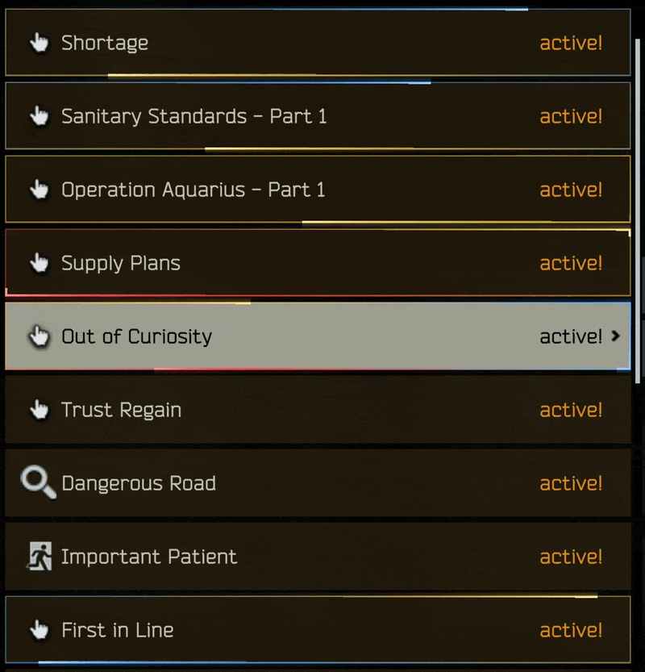
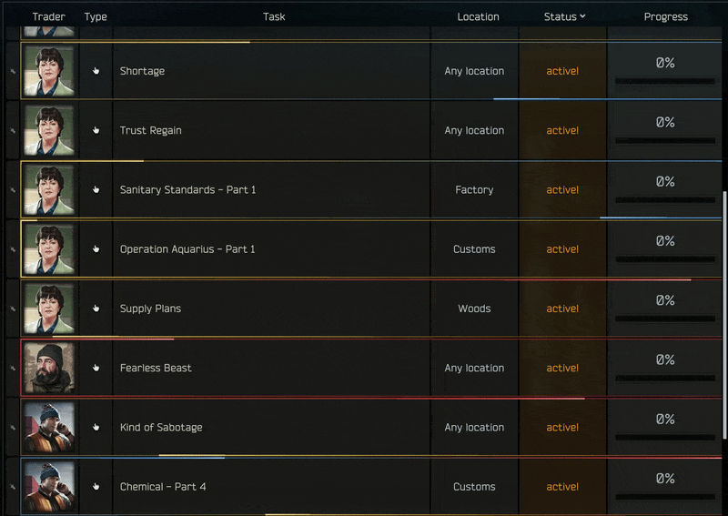

# Quest Glow

See which quests matter, right in your quest list. A glowing light runs round the edge of the quest:

- 🟡 **Gold**: needed for Kappa
- 🔵 **Blue**: needed for Lightkeeper
- 🔴 **Red**: lock-out. Finish its rival quest and this one fails for good

A quest that is more than one gets more than one light.

Shows on the trader screen and on Character > Tasks, in raid too. It only draws a marker, nothing about your quests changes.

## Install
SPT 4.1.x, client only (no server mod). Extract the zip into your SPT folder. Don't use it on a Fika headless client.

To remove it, delete `BepInEx\plugins\QuestGlow`.

## Settings
Press **F12** in game > Quest Glow. Turn each colour on or off, pick your own colours, and change the speed, length, thickness and glow. Changes show straight away.

## Problems
Report them in my Discord channel on the SPT server, in the mod comments, or on [GitHub issues](https://github.com/MrFums/QuestGlow/issues).

Claude helped with the code review, checking the quest list against SPT's data, and the docs.
